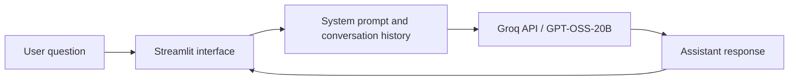
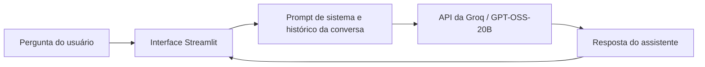

# K&G Vision — AI Coder

<!-- kg-personal-portfolio-v1 -->

[KG Professional Portfolio 1.0 — Portfólio pessoal / Personal portfolio](https://kgasil.github.io/portfolio/) · [Estudo de caso / Case study](https://kgasil.github.io/portfolio/cases.html#ai-coder)


**Project Genesis | Project #001 | v1.0 — Learning prototype**

[English](#overview) | [Português (Brasil)](#versão-em-português-pt-br)


## Overview

K&G Vision is an educational Python coding assistant prototype, designed to help beginners understand programming concepts through explanations, code examples and documentation references.

This is my first hands-on AI application exercise within Project Genesis. I reproduced and personalized a guided classroom demonstration before studying Python fundamentals, using the experience to explore how an AI chatbot works end to end.

## Technology stack

| Component | Technology |
| --- | --- |
| Application language | Python |
| Web interface | Streamlit |
| LLM provider | Groq API |
| Model configured in the prototype | GPT-OSS-20B (`openai/gpt-oss-20b`) |
| Conversation state | Streamlit session state |
| Assistant behavior | System prompt |

## Prototype design



The prototype is designed to provide conceptual explanations, commented Python examples, code walkthroughs and references to official documentation. AI-generated answers should always be checked.

## Current status

- [x] Personalized the guided classroom prototype.
- [x] Launched the Streamlit interface locally.
- [x] Practiced debugging syntax, variable names and API method calls.
- [ ] Verify end-to-end responses using a valid API key.
- [x] Publish a separate AI-assisted implementation (`code.py`).
- [x] Document local setup and pinned dependencies.
- [ ] Add automated tests.

The local interface has been demonstrated. End-to-end API behavior has not yet been independently verified. The original local prototype produced a response from Groq. This repository includes a separate ChatGPT-assisted implementation in `code.py`, not the original classroom-derived source. The public implementation has not yet been verified end to end.

## Run locally

```bash
python -m pip install -r requirements.txt
streamlit run code.py
```

Enter your own Groq API key in the sidebar. Installation in a fresh environment has not been independently verified.

## Learning roadmap

| Version | Planned milestone |
| --- | --- |
| v1.0 | Initial guided chatbot prototype |
| v2.0 | Independent implementation and interface improvements |
| v3.0 | Python file upload and code analysis |
| v4.0 | Persistent conversation storage |
| v5.0 | Retrieval-augmented generation using technical documentation |
| v6.0 | Specialized coding agents |
| v7.0 | Testing, application architecture and deployment |

These milestones are learning goals, not implemented features.

## Security

Never commit Groq API keys, environment files containing credentials, or private conversation data. Use a local secret store or password input for credentials.

## Credits

Inspired by and adapted locally from the **DSA AI Coder** introductory case study in the free *Fundamentos de Linguagem Python* course by [Data Science Academy](https://www.datascienceacademy.com.br/).

The original classroom demonstration is credited to Data Science Academy. This repository documents my learning progress and personal customization; it does not claim authorship of the original exercise or permission to redistribute its source code.

## About Project Genesis

Project Genesis is my independent learning initiative focused on building practical skills in programming, data and artificial intelligence. This repository records the starting point of that journey.

**Author of the learning documentation:** [Kaio Gabriel da Silva](https://github.com/Kgasil)


---

# Versão em português (PT-BR)

**Project Genesis | Projeto #001 | v1.0 — Protótipo de aprendizado**


## Visão geral

O K&G Vision é um protótipo educacional de assistente de programação Python, desenvolvido para ajudar iniciantes a compreender conceitos de programação por meio de explicações, exemplos de código e referências à documentação.

Este é meu primeiro exercício prático de aplicação de inteligência artificial dentro do Project Genesis. Reproduzi e personalizei uma demonstração guiada do curso antes de estudar os fundamentos de Python, utilizando essa experiência para explorar o funcionamento de um chatbot de IA de ponta a ponta.

## Tecnologias utilizadas

| Componente | Tecnologia |
| --- | --- |
| Linguagem da aplicação | Python |
| Interface web | Streamlit |
| Provedor do modelo de linguagem (LLM) | API da Groq |
| Modelo configurado no protótipo | GPT-OSS-20B (`openai/gpt-oss-20b`) |
| Estado da conversa | Gerenciamento de sessão do Streamlit |
| Comportamento do assistente | Prompt de sistema |

## Arquitetura do protótipo



O protótipo foi projetado para fornecer explicações conceituais, exemplos comentados em Python, explicações detalhadas do código e referências à documentação oficial. As respostas geradas pela IA devem sempre ser verificadas.

## Estado atual

- [x] Personalização do protótipo apresentado no curso.
- [x] Execução local da interface Streamlit.
- [x] Prática de depuração de erros de sintaxe, nomes de variáveis e chamadas de métodos da API.
- [ ] Verificar as respostas de ponta a ponta utilizando uma chave de API válida.
- [x] Publicar uma implementação separada assistida por IA (`code.py`).
- [x] Documentar instalação local e versões das dependências.
- [ ] Adicionar testes automatizados.

A interface foi demonstrada em ambiente local. O funcionamento completo da API ainda não foi verificado de forma independente. O protótipo local original recebeu uma resposta da Groq. O repositório inclui uma implementação separada assistida pelo ChatGPT no arquivo `code.py`, não o código original da aula. A versão pública ainda não foi verificada de ponta a ponta.

## Como executar localmente

```bash
python -m pip install -r requirements.txt
streamlit run code.py
```

Insira sua própria chave da Groq na barra lateral. A instalação em um ambiente novo ainda não foi verificada.

## Roteiro de aprendizado e evolução

| Versão | Etapa planejada |
| --- | --- |
| v1.0 | Protótipo inicial do chatbot desenvolvido com orientação |
| v2.0 | Implementação independente e melhorias na interface |
| v3.0 | Envio e análise de arquivos de código Python |
| v4.0 | Armazenamento persistente das conversas |
| v5.0 | Geração aumentada por recuperação (RAG) com documentação técnica |
| v6.0 | Agentes especializados em programação |
| v7.0 | Testes, arquitetura da aplicação e implantação |

Essas etapas representam objetivos de aprendizado, não funcionalidades já implementadas.

## Segurança

Nunca publique chaves da API da Groq, arquivos de ambiente contendo credenciais ou dados privados de conversas. Utilize um gerenciador local de segredos ou um campo de senha para inserir credenciais.

## Créditos

Inspirado e adaptado localmente a partir do estudo de caso introdutório **DSA AI Coder**, do curso gratuito *Fundamentos de Linguagem Python* da [Data Science Academy](https://www.datascienceacademy.com.br/).

Os créditos pela demonstração original pertencem à Data Science Academy. Este repositório documenta meu progresso de aprendizado e minha personalização do projeto, sem reivindicar a autoria do exercício original ou autorização para redistribuir seu código-fonte.

## Sobre o Project Genesis

O Project Genesis é minha iniciativa independente de aprendizado, voltada ao desenvolvimento de habilidades práticas em programação, dados e inteligência artificial. Este repositório registra o ponto de partida dessa jornada.

**Autor da documentação de aprendizado:** [Kaio Gabriel da Silva](https://github.com/Kgasil)
