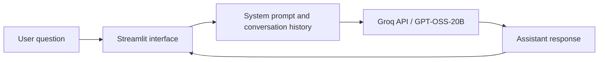

# K&G Vision — AI Coder

**Project Genesis | Project #001 | v1.0 — Learning prototype**

## Overview

K&G Vision is an educational Python coding assistant prototype, designed to help beginners understand programming concepts through explanations, code examples and documentation references.

This is my first hands-on AI application exercise within Project Genesis. I reproduced and personalized a guided classroom demonstration before studying Python fundamentals, using the experience to explore how an AI chatbot works end to end.

## Technology stack

| Component | Technology |
| --- | --- |
| Application language | Python |
| Web interface | Streamlit |
| LLM provider | Groq API |
| Model configured in the prototype | GPT-OSS-20B (`openai/gpt-oss-20b`) |
| Conversation state | Streamlit session state |
| Assistant behavior | System prompt |

## Prototype design

The prototype is designed to provide conceptual explanations, commented Python examples, code walkthroughs and references to official documentation. AI-generated answers should always be checked.

## Current status

- [x] Personalized the guided classroom prototype.
- [x] Launched the Streamlit interface locally.
- [x] Practiced debugging syntax, variable names and API method calls.
- [ ] Verify end-to-end responses using a valid API key.
- [ ] Publish authorized source code or an independently developed implementation.
- [ ] Add reproducible setup instructions and automated tests.

The local interface has been demonstrated. End-to-end API behavior has not yet been independently verified. This public repository currently documents the learning exercise; the classroom-derived source code is not included.

## Learning roadmap

| Version | Planned milestone |
| --- | --- |
| v1.0 | Initial guided chatbot prototype |
| v2.0 | Independent implementation and interface improvements |
| v3.0 | Python file upload and code analysis |
| v4.0 | Persistent conversation storage |
| v5.0 | Retrieval-augmented generation using technical documentation |
| v6.0 | Specialized coding agents |
| v7.0 | Testing, application architecture and deployment |

These milestones are learning goals, not implemented features.

## Security

Never commit Groq API keys, environment files containing credentials, or private conversation data. Use a local secret store or password input for credentials.

## Credits

Inspired by and adapted locally from the **DSA AI Coder** introductory case study in the free *Fundamentos de Linguagem Python* course by [Data Science Academy](https://www.datascienceacademy.com.br/).

The original classroom demonstration is credited to Data Science Academy. This repository documents my learning progress and personal customization; it does not claim authorship of the original exercise or permission to redistribute its source code.

## About Project Genesis

Project Genesis is my independent learning initiative focused on building practical skills in programming, data and artificial intelligence. This repository records the starting point of that journey.

**Author of the learning documentation:** [Kaio Gabriel da Silva](https://github.com/Kgasil)
